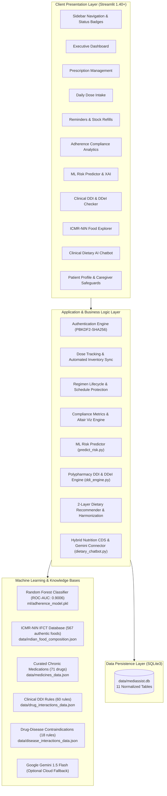
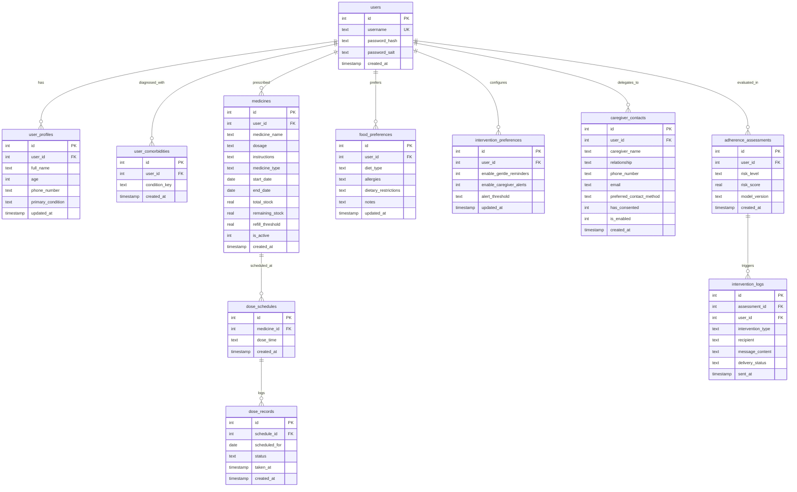

# MediAssist-AI 💚
### An Intelligent Medication Management, Polypharmacy Safety, Adherence Risk Prediction & Clinical Dietary Decision Support System

[](https://www.python.org/)
[](https://streamlit.io/)
[](https://scikit-learn.org/)
[](https://altair-viz.github.io/)
[](https://www.sqlite.org/)
[](https://ai.google.dev/)
[-059669.svg?style=flat)](https://www.nin.res.in/)
[](https://creativecommons.org/publicdomain/zero/1.0/)

---

**Capstone Project — Samsung Innovation Campus Program**  
**Engineering Team:**
- **Ankitha S** (`1DS23IS020`) — *Member 2: Medicine Management, Dose Tracking, Stock & In-App Reminders, Adherence History*
- **Shreya MV** (`1DS24CD057`) — *Member 1: Core Architecture, Session Security & Authentication, Database Engine, UI/UX Layout*
- **Harshitha R** (`1DS24CD019`) — *Member 3: Machine Learning Adherence Pipeline, Explainable AI, Dietary Recommender, Clinical Chatbot, System Integration*

---

## 📑 Table of Contents

1. [Project Overview & Clinical Problem Statement](#-1-project-overview--clinical-problem-statement)
2. [High-Level System Architecture](#-2-high-level-system-architecture)
3. [Key Modules & Technical Implementations](#-3-key-modules--technical-implementations)
   - [A. Executive Clinical Overview Dashboard (`app.py`)](#a-executive-clinical-overview-dashboard-apppy)
   - [B. Authentication & Session Security (`auth.py`)](#b-authentication--session-security-authpy)
   - [C. Daily Dose Tracking & Automated Inventory Sync (`dose_tracking.py`)](#c-daily-dose-tracking--automated-inventory-sync-dose_trackingpy)
   - [D. Prescription & Medicine Management (`medicines.py`)](#d-prescription--medicine-management-medicinespy)
   - [E. Real-Time Reminders & Refill Alerts (`reminders.py`)](#e-real-time-reminders--refill-alerts-reminderspy)
   - [F. Adherence Compliance Analytics (`adherence_history.py`)](#f-adherence-compliance-analytics-adherence_historypy)
   - [G. Explainable AI Adherence Risk Prediction (`adherence_risk.py` & `ml/`)](#g-explainable-ai-adherence-risk-prediction-adherence_riskpy--ml)
   - [H. Clinical Drug Interaction & Safety Checker (`ddi_checker.py` & `ddi_engine.py`)](#h-clinical-drug-interaction--safety-checker-ddi_checkerpy--ddi_enginepy)
   - [I. Evidence-Based Indian Food & Nutrition Recommender (`food_suggestions.py`)](#i-evidence-based-indian-food--nutrition-recommender-food_suggestionspy)
   - [J. Clinical Dietary & Nutrition AI Chatbot (`dietary_chatbot.py`)](#j-clinical-dietary--nutrition-ai-chatbot-dietary_chatbotpy)
   - [K. Patient Profile, Comorbidity Tracking & Caregiver Safeguards (`app.py`)](#k-patient-profile-comorbidity-tracking--caregiver-safeguards-apppy)
4. [Machine Learning Model Benchmark & XAI Evaluation](#-4-machine-learning-model-benchmark--xai-evaluation)
5. [Database Schema & Data Model (SQLite)](#-5-database-schema--data-model-sqlite)
6. [Curated Clinical Datasets & Knowledge Bases](#-6-curated-clinical-datasets--knowledge-bases)
7. [Repository File & Directory Structure](#-7-repository-file--directory-structure)
8. [Installation & Setup Instructions](#-8-installation--setup-instructions)
9. [Instant Demo Account & Test Drive](#-9-instant-demo-account--test-drive)
10. [Clinical References & Scientific Credits](#-10-clinical-references--scientific-credits)
11. [Ethical, Legal & Decision-Support Disclaimers](#-11-ethical-legal--decision-support-disclaimers)

---

## 📖 1. Project Overview & Clinical Problem Statement

Adherence to prescribed medication and medical nutrition therapy is the single greatest determinant of treatment success for patients managing chronic non-communicable diseases (NCDs) such as **Hypertension**, **Type 2 Diabetes**, **Dyslipidemia**, and **Chronic Kidney Disease (CKD)**. In India and developing healthcare ecosystems, chronic care patients face severe compounding barriers:

1. **Polypharmacy & Regimen Complexity:** Elderly and multi-morbid patients routinely juggle 4 to 8 distinct daily medications across variable timings (fasting, post-meal, bedtime), leading to dose omission, accidental doubling, or timing mismatches.
2. **Silent Stock Depletion:** Running out of essential chronic medications before refills are obtained accounts for up to 35% of avoidable treatment gaps.
3. **Passive, Unintelligent Reminders:** Traditional smartphone reminder apps broadcast alarms without tracking actual inventory deductions, historical compliance trajectories, or predictive risk stratification.
4. **Adverse Drug-Drug & Drug-Disease Interactions (DDI / DDeI):** Simultaneous use of common medications (e.g., Amlodipine + Clarithromycin, Telmisartan + Spironolactone, Aspirin + Ibuprofen) frequently triggers severe pharmacokinetic or pharmacodynamic interactions that go unnoticed until adverse events occur.
5. **Culturally Unaligned & Conflicting Dietary Advice:** Chronic patients often receive generic westernized dietary recommendations that fail to reflect authentic Indian cuisine (millets, pulses, traditional curries, spices). Furthermore, multi-morbid patients face dangerous dietary conflicts — such as the standard DASH diet recommending high-potassium foods that can prove fatal to a patient with concurrent Chronic Kidney Disease (CKD).
6. **Lack of Accessible Dietary Consultation:** Patients cannot readily verify whether a prepared Indian meal (such as *Khichdi*, *Idli-Sambar*, or *Poha*) is clinically safe with their specific prescriptions and health conditions.

### The MediAssist-AI Solution
**MediAssist-AI** is a privacy-first, locally deployable Clinical Decision Support System (CDSS) that synthesizes:
- **Intelligent Medication & Dose Tracking:** 1-click dose confirmation with bi-directional automated inventory synchronization.
- **Machine Learning Non-Adherence Prediction:** An offline-trained Random Forest classifier (**ROC-AUC: 0.9006**, **Precision: 92.86%**) calibrated on 24,084 chronic patient records from Mendeley Data.
- **Explainable AI (XAI) & Counterfactual "What-If" Simulation:** Identifies patient-specific risk escalators vs. protective factors and allows real-time regimen sensitivity testing.
- **Comprehensive DDI & DDeI Polypharmacy Engine:** Audits active regimens across 71 curated chronic medications, 60 clinical DDI rules, and 18 drug-disease contraindications.
- **ICMR-NIN Indian Food Composition Engine:** 567 authentic foods across 12 categories with automated allergen filtering, multi-condition clinical harmonization (Renal, Gout, GERD overrides), and drug-nutrient synergy tagging.
- **Hybrid Clinical Nutrition Chatbot:** Dual-engine conversational agent featuring a 100% offline rule-based CDS engine and an optional Google Gemini 1.5 Flash API connector grounded in the patient's verified health profile.

---

## 🏛️ 2. High-Level System Architecture



---

## 🌟 3. Key Modules & Technical Implementations

### A. Executive Clinical Overview Dashboard (`app.py`)
The home dashboard provides an immediate, unified command center for patients and caregivers:
- **Time-Aware Personalized Greeting:** Dynamically greets the patient based on local wall-clock hours (*Good morning / afternoon / evening*).
- **Adherence Streak Counter:** Real-time computation of consecutive days with 100% adherence (`🔥 X Day Streak`), motivating sustained routine stability.
- **Intake Progress Bar:** Visual progress bar tracking today's confirmed doses against total scheduled doses with status callouts (`All Completed`, `X Due / Pending`, or `No Doses Scheduled`).
- **Live KPI Metric Cards:**
  - `Active Prescriptions`: Total count of active ongoing regimens.
  - `Today's Doses`: Completed intake fraction (e.g. `2 / 3`).
  - `15-Day Adherence`: Percentage of confirmed doses over the rolling 15-day clinical window.
  - `Stock Status`: Real-time indicator alerting if any medication is at or below refill thresholds (`X Alert` vs. `Optimal`).
- **Proactive Safety Alerts:** Dynamically scans active prescriptions upon page load and surfaces high-visibility warning banners if Severe (Contraindicated) drug-drug interactions or depleted stocks are detected, providing one-click deep links to resolve them.
- **Quick Action Cards:** Rapid navigation to *Dose Tracking*, *My Medicines*, *Safety Scan*, and *Dietary AI Chat*.
- **Recent Medication Events Feed:** Displays the 5 most recent dose confirmations with color-coded status badges (`Taken`, `Missed`, `Unconfirmed`), dosages, and exact timestamps.

### B. Authentication & Session Security (`auth.py`)
- **Cryptographic Password Protection:** Utilizes salted `PBKDF2-HMAC-SHA256` hashing with **600,000 iterations** and a 16-byte cryptographically secure pseudo-random salt (`secrets.token_hex(16)`).
- **Session State Isolation:** Prevents multi-tenant data leakage by binding database queries strictly to the active authenticated `user_id`.
- **Validation & Defense:** Enforces username length, password complexity, and graceful error reporting for duplicate usernames.

### C. Daily Dose Tracking & Automated Inventory Sync (`dose_tracking.py`)
- **Date-Filtered Regimen Fetching:** Queries all active regular medicines and temporary acute courses valid for the selected date.
- **One-Click Intake Confirmation:** Simple button interactions to mark scheduled doses as `Taken` or `Missed`.
- **Bi-Directional Automated Stock Deduction:**
  - Marking a dose `Taken` automatically decrements `remaining_stock` by 1 unit in SQLite.
  - Marking a dose `Missed` leaves inventory untouched.
  - Resetting or reversing an earlier `Taken` dose safely restores 1 unit to `remaining_stock` (capped at `total_stock`).
- **Zero-Stock Exhaustion Guard:** Intercepts confirmations if remaining stock is 0, warning the patient to refill immediately.
- **Celebration Trigger:** Triggers confetti / celebratory visual feedback when 100% of today's scheduled doses are marked taken.

### D. Prescription & Medicine Management (`medicines.py`)
- **Dual-Tab Architecture:** Clean tabbed workflow separating "Add Medicine" from "My Prescriptions".
- **Pre-Loaded Quick-Select Presets:** Dropdown pre-populated with **71 common chronic medications** across antidiabetics, antihypertensives, statins, antiplatelets, PPIs, and thyroid drugs. Selecting a preset auto-fills standard names and unlocks integrated clinical nutritional guidance.
- **Multi-Dose Schedule Generator:** Configures 1, 2, 3, or 4 daily dose timings with dedicated time pickers.
- **Regimen Types:**
  - *Regular:* Continuous chronic therapy with start date and ongoing duration.
  - *Temporary:* Acute therapy (e.g. antibiotics, short anti-inflammatory courses) with required start and end dates.
- **Inventory & Refill Threshold Management:** Captures initial stock count and custom low-stock thresholds (e.g., alert when $\le 5$ pills remain).
- **1-Click Quick Refill (+30 Units):** Instant top-up button directly on each prescription card for rapid inventory restocking without re-entering edit forms.
- **Embedded Food & Nutrition Guidance:** Expandable clinical guidance card under each prescription detailing therapeutic category, optimal meal timing, critical dietary warnings, foods to avoid, and beneficial dietary synergies.
- **Schedule History Protection:** Updating prescription names, stock, or instructions preserves existing historical dose records; deleting a medicine is safely blocked if historical dose records depend on it.

### E. Real-Time Reminders & Refill Alerts (`reminders.py`)
- **Pending Due-Dose Interception:** Identifies active doses scheduled up to the current wall-clock hour that remain unconfirmed for today, surfacing them in order of urgency with a direct "Confirm Intake Now" navigation button.
- **Low-Stock Warning Cards:** Evaluates `remaining_stock <= refill_threshold` across all active prescriptions and displays urgent visual cards with pill counts, progress bars, and inline "+30 Units" quick-refill actions.

### F. Adherence Compliance Analytics (`adherence_history.py`)
- **Configurable Evaluation Windows:** Evaluates compliance across **7-day**, **15-day**, or **30-day** rolling clinical windows.
- **Mathematical Compliance Computation:**
  $$\text{Adherence Rate (\%)} = \frac{\text{Taken Doses}}{\text{Taken Doses} + \text{Missed Doses}} \times 100$$
- **Streak Calculation:** Calculates uninterrupted consecutive days where all scheduled doses were taken with zero missed doses.
- **Clinical Compliance Stratification:**
  - `🟢 Optimal Compliance (≥ 80%)`: High adherence strongly associated with reduced risk of chronic microvascular and macrovascular complications.
  - `🟡 Suboptimal Compliance (< 80%)`: Highlights elevated non-adherence risk and recommends schedule simplification or caregiver check-in.
- **Interactive Altair Data Visualizations:**
  - *Daily Dose Distribution Bar Chart:* Stacked daily bar chart breaking down Taken (emerald), Missed (red), and Unconfirmed (amber) doses over the selected evaluation timeline.
  - *Compliance Ratio Donut Chart:* Proportional breakdown of confirmed taken vs. missed doses.
- **Comprehensive Historical Audit Table:** Chronological log displaying date, time, medicine name, dosage, and status badges.

### G. Explainable AI Adherence Risk Prediction (`adherence_risk.py` & `ml/`)
- **Offline Machine Learning Pipeline:** Trained on **24,084 chronic patient records** from the peer-reviewed *Mendeley Data Chronic Adherence Cohort* (Version 2, DOI: `10.17632/zkp7sbbx64.2`).
- **Standardized Feature Pipeline:** 11 clinical and socio-demographic features including Patient Age, Dispensed Units (`UNITSTOTAL`), Annual Claims, Annual Contributions, Coverage Tiers, Hypertension diagnosis, Comorbidities (`COMORBIDITY_NO_COMORBIDITY`), and Secondary Complications.
- **Tri-Tier Risk Stratification:**
  - `Low Risk (≤ 33%)`: Regimen stability optimal; routine encouragement.
  - `Medium Risk (34% – 66%)`: Moderate vulnerability; suggests timing simplification and proactive refill notifications.
  - `High Risk (> 66%)`: Severe vulnerability to dose omissions; triggers clinical review and caregiver check-in alerts.
- **Population Standing Benchmark:** Calibrates the patient's individual non-adherence probability against the full 24,084 patient cohort, reporting their percentile standing (e.g. *Top 18% Adherence Standing*, cohort median, and cohort mean).
- **Explainable AI (XAI) Factor Attribution:**
  - Mathematical perturbation analysis measuring feature impact on predicted risk.
  - Rendered as an interactive Altair horizontal bar chart classifying factors into **Risk Escalators** (red) and **Protective Factors** (emerald) accompanied by clinical rationales.
- **Interactive Counterfactual "What-If" Sensitivity Simulator:**
  - Tests hypothetical regimen alterations in real time:
    - *Scenario A: Supply Disruption:* Dispensed refill units drop by 75%.
    - *Scenario B: Secondary Complications Emerge:* Disease progresses with secondary complications.
    - *Scenario C: Regimen Simplification:* Polypharmacy resolved to single-medication therapy.
  - Displays baseline risk vs. simulated risk along with exact percentage delta ($\Delta\%$).
- **Audit Logging:** Logs assessments to SQLite `adherence_assessments` and triggers caregiver alerts if risk exceeds configured thresholds.

### H. Clinical Drug Interaction & Safety Checker (`ddi_checker.py` & `ddi_engine.py`)
- **71 Curated Chronic Medications:** Full pharmacokinetic and pharmacodynamic indexing with generic names and Indian brand equivalents (*Glycomet, Amlong, Telma, Atorva, Pan-40, Thyronorm, Dolo 650, Ecosprin, Shelcal, etc.*).
- **60 Pairwise Clinical DDI Rules:**
  - `🔴 Severe / Contraindicated`:
    - *Amlodipine + Clarithromycin:* Strong CYP3A4 inhibition elevates CCB serum levels, causing severe hypotension, peripheral edema, and acute kidney injury.
    - *Telmisartan + Spironolactone:* Dual renin-angiotensin-aldosterone blockade precipitates severe hyperkalemia, cardiac arrhythmias, and renal failure.
    - *Aspirin + Ibuprofen:* Competitive COX-1 binding attenuates aspirin's cardioprotective antiplatelet effect and multiplies gastric bleeding risks by 4–6x.
    - *Digoxin + Amiodarone:* P-glycoprotein and renal clearance inhibition causes lethal digitalis toxicity.
  - `🟠 Major Precautions`:
    - *Clopidogrel + Omeprazole:* CYP2C19 inhibition prevents prodrug bioactivation of clopidogrel, elevating stent thrombosis risk.
    - *Atenolol + Glimepiride:* Beta-blockade masks autonomic hypoglycemia warning signs (tremors, palpitations) and delays glycemic recovery.
    - *Enalapril + Diclofenac:* NSAID prostaglandin inhibition blunts ACE-inhibitor antihypertensive efficacy and triggers acute renal deterioration.
  - `🟡 Moderate / Synergies`: Mild interactions, timing spacing rules, and clinical monitoring recommendations.
- **18 Drug-Disease Interaction (DDeI) Rules:**
  - Cross-references active medications against diagnosed patient comorbidities:
    - *Asthma + Non-selective Beta-blockers (Propranolol, Carvedilol):* 🔴 Severe Bronchospasm & Respiratory Arrest.
    - *CKD + NSAIDs (Ibuprofen, Diclofenac):* 🔴 Severe Acute-on-Chronic Renal Decompensation.
    - *Heart Failure + Non-DHP CCBs (Verapamil, Diltiazem) / Glitazones (Pioglitazone):* 🔴 Decompensated Heart Failure & Pulmonary Edema.
    - *Gout + Thiazide/Loop Diuretics (Chlorthalidone, HCTZ, Furosemide):* 🟠 Hyperuricemia & Acute Gout Attacks.
    - *GERD / Peptic Ulcer + NSAIDs / Aspirin:* 🔴 Gastric Mucosal Erosions & Hemorrhage.
    - *Liver Impairment + Paracetamol:* 🟠 Hepatotoxicity at standard doses due to glutathione depletion.
- **Interactive Multi-Drug Simulator:** Sandbox allowing patients or clinicians to test any combination of 2 or more medications with 1-click clinical preset triads.

### I. Evidence-Based Indian Food & Nutrition Recommender (`food_suggestions.py`)
- **567 Authentic Indian Foods:** Curated directly from the official **Indian Food Composition Tables (IFCT / ICMR-NIN)** across all 12 food categories:
  - *Millets & Whole Grains* (Ragi, Bajra, Jowar, Foxtail Millet, Brown Rice, Oats)
  - *Pulses & Legumes* (Moong Dal, Chana Dal, Rajma, Kabuli Chana, Masoor Dal)
  - *Green Leafy Vegetables* (Palak, Methi, Amaranth, Moringa Leaves, Sarson)
  - *Other Vegetables* (Bhindi, Karela, Lauki, Baingan, Shimla Mirch)
  - *Roots & Tubers* (Shakarkand, Mooli, Gajar, Arbi)
  - *Fruits* (Amla, Papaya, Guava, Apple, Jamun, Pomegranate)
  - *Nuts & Oilseeds* (Almonds, Walnuts, Flaxseeds, Chia Seeds, Til)
  - *Spices & Condiments* (Haldi, Dalchini, Jeera, Ajwain, Methi Dana, Garlic)
  - *Dairy Products* (Low-fat Dahi, Paneer, Skimmed Milk, Chaas)
  - *Fish, Poultry & Eggs* (Egg White, Rohu, Hilsa, Chicken Breast)
  - *Beverages* (Green Tea, Coconut Water, Buttermilk, Lemon Water)
  - *Healthy Cooking Fats* (Mustard Oil, Til Oil, Rice Bran Oil, Cold-Pressed Groundnut Oil)
- **Two-Layer Recommendation Architecture:**
  - `Layer 1: Zero-Tolerance Safety Filter:` Eliminates declared allergens (`peanuts`, `dairy`, `gluten`, `soy`, `eggs`, `fish`, `shellfish`, `tree nuts`, `sesame`) and enforces strict diet types (`Vegetarian`, `Vegan`, `Eggetarian`, `Non-vegetarian`, `Pescatarian`).
  - `Layer 2: Multi-Attribute Utility Scoring:` Scores and ranks foods according to clinical condition utility formulas:
    - *Hypertension / DASH Diet:* Rewards high potassium, calcium, and magnesium; severely penalizes sodium.
    - *Type 2 Diabetes / Glycemic Control:* Strongly rewards low Glycemic Index (GI $\le 55$) and high dietary fiber; penalizes high glycemic carbs.
    - *Heart-Healthy / Dyslipidemia:* Prioritizes soluble fiber, omega-3 fatty acids, and low saturated fats.
- **Multi-Morbid Clinical Dietary Harmonization:** Resolves conflicting dietary needs across overlapping chronic conditions:
  - *Renal Safety Override (CKD + Hypertension):* Automatically caps potassium at $\le 250\text{ mg}/100\text{g}$ and restricts phosphorus to protect failing kidneys against fatal hyperkalemia, safely superseding the standard high-potassium DASH guidelines.
  - *Purine Safety Override (Gout):* Excludes high-purine meats and seafood while boosting uric-acid-lowering foods (cherries, amla, low-fat dahi).
  - *Mucosal Protection (GERD / Ulcers):* Eliminates acidic citrus, spicy peppers, and fried triggers, promoting alkaline, soothing staples.
- **Search, Filters & Drug-Nutrient Synergy Badges:**
  - Search by English name, Hindi / regional name (e.g. *Karela, Palak, Methi, Ragi, Amla*), or specific nutrients.
  - Dynamic pagination (20 foods per page).
  - Food cards display real-time drug badges: 🛑 Contraindicated (e.g. Grapefruit with Amlodipine/Atorvastatin), ⏱️ Spacing Required (e.g. Dairy 2h away from Iron/Ciprofloxacin), and 🌟 Therapeutic Synergy (e.g. Antioxidants with Statins).

### J. Clinical Dietary & Nutrition AI Chatbot (`dietary_chatbot.py`)
A state-of-the-art conversational medical nutrition agent built on a **Hybrid Architecture**:
1. **100% Local Offline CDS Engine (Default):**
   - Operates completely offline with zero internet access or external API keys required.
   - Built-in clinical intelligence across 10 specialized intents:
     - *Prepared Indian Dishes:* Nutritional and glycemic breakdown of traditional staples (*Khichdi, Idli, Dosa, Poha, Upma, Roti, Dal Tadka, Biryani, Curd Rice, Sambar, Jaggery*).
     - *Pharmacological Mechanisms ("Why"):* Explains the physiological mechanisms behind medication guidelines (e.g., why Atorvastatin is taken at bedtime due to nocturnal hepatic cholesterol synthesis; why Metformin is taken with meals to prevent gastrointestinal upset; why ACE inhibitors cause dry cough via bradykinin accumulation; why Levothyroxine requires an empty stomach).
     - *Digestive & Symptom Support:* Actionable clinical guidance for acidity/GERD, bloating, constipation, postprandial fatigue, indigestion, and hypoglycemia.
     - *Food Comparisons:* Evidence-based comparative analyses (e.g., *Brown Rice vs. White Rice*, *Roti vs. Rice*, *Cow Milk vs. Almond Milk*, *Ghee vs. Mustard Oil*).
     - *Chronobiology & Lifestyle:* Guidance on late-night eating, intermittent fasting safety under antidiabetic therapy, hydration, and salt restriction.
     - *Dynamic Meal Planning:* Context-aware breakfast, lunch, snack, and dinner suggestions customized to the patient's exact restrictions.
     - *Food Safety Evaluation:* Interactively evaluates any food against active prescriptions, allergies, and comorbidities.
     - *Nutrient Lookups:* Identifies foods rich or low in potassium, sodium, fiber, protein, calcium, or iron.
2. **Optional Google Gemini API Connector (Hybrid Cloud Mode):**
   - Seamlessly activates when the user inputs a Google Gemini API key (Free Tier `gemini-1.5-flash`).
   - Zero additional dependencies — utilizes standard Python `requests`.
   - Injects the patient's verified clinical profile (diagnosed conditions, active prescriptions, dosages, allergens, diet type) directly into the system prompt context.
   - Gracefully falls back to the local offline CDS engine if network errors occur or if no API key is provided.
3. **Interactive Streamlit Chat Interface:**
   - Real-time conversation thread with user and clinical assistant avatars.
   - Pre-configured quick-prompt suggestion chips for rapid testing.
   - Expandable API configuration box and 1-click conversation history clearing.

### K. Patient Profile, Comorbidity Tracking & Caregiver Safeguards (`app.py`)
- **Demographics & Chronic Conditions Checklist:** Captures age, primary health condition, and an active checklist of 9 major chronic conditions (Hypertension, Diabetes, CKD, Heart Failure, Gout, GERD, Asthma, Liver Disease, Dyslipidemia). Diagnosed conditions automatically propagate to SQLite `user_comorbidities`.
- **Dietary & Allergen Preferences:** Stores diet type, freeform and structured allergens, and sodium/sugar restrictions.
- **Caregiver Safeguards & Escalation:**
  - Configurable caregiver contacts (name, relationship, phone, email).
  - Explicit verified caregiver consent tracking (`has_consented`).
  - Automated threshold configuration (`High Risk Only` vs. `Medium or High Risk`).
  - Transparent delivery audit log (`intervention_logs`) tracking supportive notifications.

---

## 🧠 4. Machine Learning Model Benchmark & XAI Evaluation

### Dataset Specifications
- **Source:** *Dataset for analysing medication adherence among diabetes and hypertension patients: Patient-level and medication refill data*, Mendeley Data, Version 2, DOI: `10.17632/zkp7sbbx64.2` (CC0 1.0 Public Domain).
- **Cohort Size:** 24,084 chronic patients (14,415 Non-Adherent, 9,669 Adherent).
- **Features (11):** `AGE`, `UNITSTOTAL`, `ANNUALCONTRIBUTION`, `ANNUALCLAIMAMOUNT`, `GENDER_M`, `SCHEMETYPE_MEDIUM`, `SCHEMETYPE_PREMIUM`, `DIAGNOSIS_HYPERTENSION`, `COVERTYPE_STANDARD`, `COMORBIDITY_NO_COMORBIDITY`, `COMPLICATIONDEVELOPMENT_NO_COMPLICATION`.

### Model Comparison Benchmark (80/20 Stratified Split)

| Algorithm | ROC-AUC | Accuracy | Precision (Non-Adherent) | Recall (Non-Adherent) | F1-Score | Status |
| :--- | :---: | :---: | :---: | :---: | :---: | :---: |
| **Logistic Regression** (Baseline) | 0.6586 | 61.86% | 69.72% | 64.13% | 0.6681 | Baseline |
| **Decision Tree** | 0.8893 | 80.59% | 91.95% | 74.05% | 0.8204 | Candidate |
| **Random Forest Classifier** | **0.9006** | **81.03%** | **92.86%** | **73.99%** | **0.8236** | **Selected Best** |

### Confusion Matrix (Random Forest on Test Set)
```
                Predicted Adherent    Predicted Non-Adherent
Actual Adherent         1,770 (TN)               164 (FP)
Actual Non-Adherent       750 (FN)             2,133 (TP)
```
- **92.86% Precision** on the non-adherent risk class ensures that when MediAssist-AI flags a patient as high risk, it is correct over 9 times out of 10, drastically minimizing false alarms and caregiver alert fatigue.
- Pipeline serialized via Joblib to `ml/adherence_model.pkl`.

---

## 🗄️ 5. Database Schema & Data Model (SQLite)

The SQLite database (`data/mediassist.db`) maintains **11 normalized, foreign-key-constrained tables**:



---

## 📚 6. Curated Clinical Datasets & Knowledge Bases

| Knowledge Base File | Category / Domain | Scale / Records | Key Clinical Attributes |
| :--- | :--- | :--- | :--- |
| `data/indian_food_composition.json` | Authentic Indian Nutrition (ICMR-NIN IFCT) | **567 Foods** across 12 categories | English & Hindi names, Energy, Protein, Carbs, Fat, Fiber, Potassium, Sodium, Calcium, Phosphorus, Iron, Glycemic Index tier |
| `data/medicines_data.json` | Curated Chronic Medications | **71 Medications** | Generic names, Indian brands (*Glycomet, Amlong, Telma, Atorva, Pan-40, etc.*), dosages, therapeutic classes, meal timing, food precautions, synergies |
| `data/drug_interactions_data.json` | Pharmacological DDI Rules | **60 Clinical Rules** | Severe, Major, and Moderate classifications, CYP450 pharmacokinetic mechanisms, clinical consequences, doctor guidance |
| `data/disease_interactions_data.json` | Drug-Disease Contraindications (DDeI) | **18 Contraindications** | 9 Comorbidities (Asthma, CKD, Heart Failure, Gout, GERD, Liver Disease, etc.), contraindicated drug classes, clinical risks |
| `ml/dataset.csv` | Chronic Patient Medication Adherence | **24,084 Patients** | Patient age, refill unit counts, annual claims, coverage tiers, hypertension, comorbidities, complications, binary adherence label |

---

## 📂 7. Repository File & Directory Structure

```
MediAssist-AI-main/
│
├── app.py                          # Streamlit application entry point, custom CSS & navigation controller
├── auth.py                         # PBKDF2-HMAC-SHA256 authentication & session security engine
├── database.py                     # SQLite connection manager, schema initialization (11 tables) & migrations
├── dose_tracking.py                # Daily dose intake confirmation & automated inventory synchronization
├── medicines.py                    # Prescription management, multi-dose scheduling & quick-refill (+30)
├── reminders.py                    # Real-time wall-clock pending reminders & low-stock refill alerts
├── adherence_history.py            # 7/15/30-day compliance analytics, streak calculation & Altair visualizations
├── adherence_risk.py               # AI risk interface, population standing, factor attribution & what-if simulator
├── ddi_engine.py                   # Polypharmacy engine (pharmacokinetic CYP450 DDI & comorbidity DDeI)
├── ddi_checker.py                  # DDI UI: Active regimen safety audit & interactive multi-drug simulator
├── food_suggestions.py             # ICMR-NIN food recommender, multi-morbid harmonization & drug-nutrient tags
├── dietary_chatbot.py              # Hybrid clinical nutrition chatbot (100% offline CDS engine + Gemini fallback)
├── medicine_food_integration.py    # Cross-referencing active SQLite prescriptions against foods and nutrients
├── seed_demo_data.py               # 1-command realistic chronic care seeder (demo_patient / Demo@12345)
├── requirements.txt                # Production Python dependencies
├── README.md                       # Comprehensive system documentation and technical specifications
│
├── data/
│   ├── mediassist.db               # SQLite database file
│   ├── indian_food_composition.json# 567 ICMR-NIN authentic Indian foods database
│   ├── medicines_data.json         # 71 curated chronic medications database
│   ├── drug_interactions_data.json # 60 pairwise clinical DDI rules
│   └── disease_interactions_data.json # 18 drug-disease contraindication rules
│
├── ml/
│   ├── adherence_model.pkl         # Trained Random Forest classifier pipeline (Joblib)
│   ├── dataset.csv                 # Mendeley Data chronic adherence cohort (24,084 records)
│   ├── evaluation_report.json      # Model benchmark metrics, ROC-AUC, accuracy, precision, confusion matrix
│   ├── predict_risk.py             # Feature preprocessing, inference, XAI factor attribution & what-if simulator
│   ├── preprocessing.py            # Feature transformation and encoding pipeline
│   └── train_model.py              # Stratified split, training, evaluation, and serialization script
│
└── scripts/                        # Data generation, expansion & IFCT database compilation scripts
    ├── build_ifct_database.py
    ├── expand_medicines_and_ddi.py
    ├── generate_disease_interactions.py
    └── ...
```

---

## 💻 8. Installation & Setup Instructions

### Prerequisites
- Python 3.10 or higher (fully tested on Python 3.13)
- Windows, macOS, or Linux
- Modern web browser (Chrome, Edge, Firefox, Safari)

### 1. Clone Repository
```bash
git clone https://github.com/YourUsername/MediAssist-AI.git
cd MediAssist-AI
```

### 2. Set Up Virtual Environment
```powershell
# Windows (PowerShell)
python -m venv .venv
.venv\Scripts\Activate.ps1

# Linux / macOS (Bash)
python3 -m venv .venv
source .venv/bin/activate
```

### 3. Install Dependencies
```bash
pip install -r requirements.txt
```

### 4. (Optional) Retrain Machine Learning Model
The pre-trained model is bundled at `ml/adherence_model.pkl`. To retrain the Random Forest classifier directly on the 24,084 patient dataset:
```bash
python ml/train_model.py
```

### 5. Launch MediAssist-AI
```bash
streamlit run app.py
```
Open your web browser at `http://localhost:8501`.

---

## 🚀 9. Instant Demo Account & Test Drive

MediAssist-AI includes a pre-packaged demonstration data seeder (`seed_demo_data.py`). Run the seeder to instantly populate a realistic, multi-morbid chronic care patient profile:

```bash
python seed_demo_data.py
```

### Demonstration Credentials
- **Username:** `demo_patient`
- **Password:** `Demo@12345`

### Pre-Configured Demo Profile
- **Demographics:** Age 58, diagnosed with **Hypertension** and **Type 2 Diabetes**.
- **Food Profile:** Vegetarian, peanut allergy, low-sodium and low-sugar restrictions.
- **Active Prescriptions:**
  - *Metformin (500mg):* Oral antidiabetic with morning and evening post-meal dose schedules.
  - *Amlodipine (5mg):* Calcium channel blocker taken once daily in the morning.
  - *Atorvastatin (10mg):* Statin taken once daily at bedtime (triggers grapefruit CYP3A4 safety alerts).
- **Compliance History:** 15 consecutive days of historical dose records (~83% compliance rate) with active streak data.
- **Caregiver Contact:** Sunita Sharma (Spouse) configured with verified consent.

---

## 🔬 10. Clinical References & Scientific Credits

1. **Adherence Cohort Dataset:** *Dataset for analysing medication adherence among diabetes and hypertension patients: Patient-level and medication refill data*, Mendeley Data, Version 2, DOI: `10.17632/zkp7sbbx64.2` (CC0 1.0 Public Domain).
2. **Indian Nutrition Data:** *Indian Food Composition Tables (IFCT 2017)*, National Institute of Nutrition (ICMR-NIN), Indian Council of Medical Research, Department of Health Research, Ministry of Health & Family Welfare, Government of India.
3. **Hypertension Guidelines:** *2017 ACC/AHA/AAPA/ABC/ACPM/AGS/APhA/ASH/ASPC/NMA/PCNA Guideline for the Prevention, Detection, Evaluation, and Management of High Blood Pressure in Adults*, Journal of the American College of Cardiology.
4. **Diabetes Nutritional Consensus:** *American Diabetes Association (ADA) Standards of Care in Diabetes — 2024: Facilitating Positive Health Behaviors and Well-being to Improve Health Outcomes*, Diabetes Care.
5. **Renal Nutritional Safety:** *KDIGO 2024 Clinical Practice Guideline for the Evaluation and Management of Chronic Kidney Disease*, Kidney International.
6. **Drug Interaction Mechanisms:** *Cytochrome P450 Drug Interaction Table*, Department of Medicine, Indiana University School of Medicine; and FDA Drug Development and Drug Interactions Guidance.

---

## 🛡️ 11. Ethical, Legal & Decision-Support Disclaimers

> [!WARNING]
> **Educational & Clinical Decision-Support Notice:**  
> **MediAssist-AI** is designed strictly as an assistive medication management, risk-stratification, and dietary educational tool. It does **NOT** provide definitive medical diagnoses, prescribe prescription medications, alter clinical dosages, or substitute for the clinical judgment of licensed physicians, pharmacists, or registered dietitians.
> 
> Patients must always consult their treating healthcare providers before initiating, altering, or discontinuing any medication or dietary plan. The machine learning adherence risk score is an empirical probabilistic estimation based on retrospective chronic refill cohorts and should be interpreted by healthcare providers in conjunction with comprehensive clinical assessments. All data is processed locally with zero patient health information transmitted to external servers without explicit user-initiated API activation.
